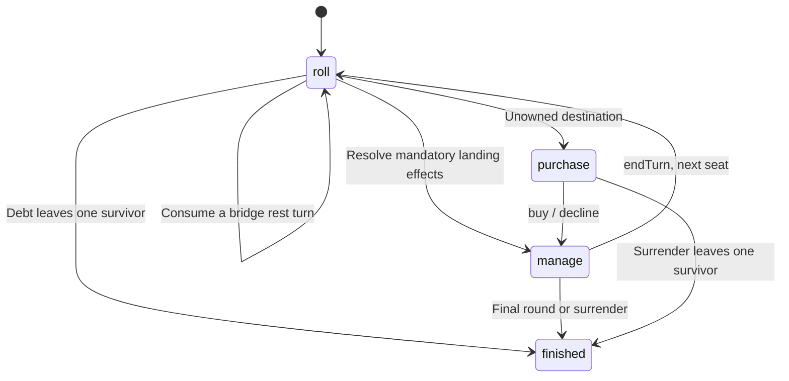

# Monopoly v4 technical architecture

[中文](TechnicalArchitecture.md) · [Rules](game-rules.en.md) · [Protocol](../../server/PROTOCOL.md)

v4 extracts the game rules into one dependency-free ESM engine. Offline play calls it in the browser; online play calls it on the authoritative server and broadcasts complete snapshots. Clients submit commands, never money, dice, ownership or their own resulting game state.

## Module boundaries

| Path | Responsibility |
| --- | --- |
| `shared/data.js` | One bilingual source for 36 cells, 21 properties and color groups |
| `shared/index.js` | Rule parameters, pure state transitions, legal commands, valuation, rent and AI |
| `shared/CONTRACT.md` | State, commands, error codes and parameter contract |
| `monopoly/src/App.vue` | Local play, room play, actions and page state |
| `monopoly/src/components/` | Board and property presentation |
| `monopoly/src/i18n.js` | Chinese/English interface, errors and structured-log formatting |
| `monopoly/src/online/client.js` | WebSocket requests, snapshots, sessions and reconnection |
| `server/server.js` | Static HTTP service, rooms, authentication, revisions, authoritative actions and timers |
| `tests/engine.test.js` | Rules and AI regression coverage |
| `tests/server.test.js` | Real local HTTP/WebSocket integration coverage |
| `scripts/simulate.js` | Seeded AI self-play with rotating difficulties and seats |

The repository is an npm workspace with `monopoly` and `server` packages. The frontend uses Vue 3 and Vite; the backend uses Node.js HTTP and `ws`. The shared engine has no third-party dependencies. See the root `package.json` for the required runtime version.

## State and commands

```js
const state = createGame({ players, seed, maxRounds: 40 });
const actions = getLegalActions(state, playerId);
const next = applyAction(state, playerId, actions[0]);
```

`applyAction` never mutates its input. Every accepted command returns a fresh JSON-serializable state and increments `revision` once. Rejected commands throw an error with a stable `code`. State includes version 4, rounds, the current player ID, cash, assets, ecology, logs, winners and private random state. Player IDs stay stable; bankruptcy never renumbers other seats by removing an array entry.

Clients use `getLegalActions` for available controls, and the engine independently checks each submission. The normal state machine is:



Management commands are `build`, `sellBuilding`, `mortgage`, `redeem`, `aquaculture`, `equip` and `invest`. `surrender` is the only command available to a non-current surviving player. A purchase must be bought or declined before management; rent and penalties settle automatically. Finished matches reject every command.

Net worth, debt settlement, group bonuses and exclusive upgrade paths each have one implementation. Debt liquidation precedes the actual transfer; unpaid debt never increases the creditor's cash. Mortgage valuation subtracts principal, and the landmark set awards conditional score only. See the [rules](game-rules.en.md) and shared exports for parameters.

## Offline execution

Local actions call the shared transition function directly; bots use the same `chooseAIAction` and `applyAction` functions. The browser saves accepted v4 states in `localStorage`, allowing a local game to continue. Multiple human players share the device through turn handoff. v3 saves are not migrated.

Offline random results are seeded. A seed, player order, round limit and action sequence can reproduce a failure. Restoring a local save restores its random-generator state rather than starting a new sequence. The generator serves gameplay and debugging, not cryptographic purposes.

## Online authority and snapshots

Production HTTP and WebSocket traffic use one service. The browser derives `/ws` from the current origin and selects `wss:` on HTTPS pages. During development, Vite proxies `/ws` to the local backend. There is no hard-coded public address or manual server-address field.

Requests are `{id,type,payload}`. For example:

```json
{
  "id": "request-123",
  "type": "action",
  "payload": { "revision": 12, "action": { "type": "build", "propertyId": "prop_03" } }
}
```

The server derives the seat from its authenticated socket binding, validates the room, turn, revision and command, then applies the engine. It broadcasts `{type:"snapshot",payload:{room,game}}`. Clients replace their online state with the authoritative snapshot rather than applying optimistic money changes or a separate settlement implementation.

- Each connection caches its latest 128 request IDs. Identical retries return cached replies; reusing an ID for different content is rejected.
- Game commands require the current revision; stale submissions receive `STALE_REVISION`.
- Reconnection never automatically replays unacknowledged commands. The client resumes its session and accepts the latest snapshot.
- Snapshots contain up to 200 structured log events. Clients translate event codes without requiring a server-side language preference.
- Public snapshots exclude `seed`, `rngState`, session tokens and token digests. Before every online roll, Node.js cryptographic entropy refreshes the internal random state. Opening-seed-only online replay is therefore unsupported.

See [PROTOCOL.md](../../server/PROTOCOL.md) for message and error definitions.

## Sessions, disconnects and automatic turns

Creating or joining returns a room code, stable player ID and private session token. The client stores these per tab in `sessionStorage` and uses them to reclaim the same seat after refreshing or reconnecting. The server stores SHA-256 token digests and compares them in constant time. A resumed connection replaces an older socket for that seat.

An ordinary disconnect preserves the seat, assets and session. Human turns have a fixed **60-second deadline** by default; asset-management commands do not extend it. At expiry, the shared AI finishes that turn. After reconnecting, manual play resumes on the next personal turn. The host role migrates when its owner disconnects or leaves.

Explicitly leaving an active room differs from surrender: `leave` permanently converts the seat into a bot, retains its assets and invalidates its session token. `surrender` uses the engine's bankrupt-style exit. Automated actions are paced at approximately 200 ms each.

Starting requires 2–4 seats, connected and ready humans, and a host command. Finished rooms can restart. The host can remove disconnected waiting humans and add or remove bots. Humans cannot join an active game.

## Runtime and deployment boundary

The server is a **single-process, in-memory room service**. It has no database, cross-process coordination, account system or persistent matches. A restart clears rooms and sessions. Rooms without connected humans expire after roughly 30 minutes; inactive rooms expire after roughly 24 hours. Do not run multiple workers or load-balanced replicas.

The server exposes `/healthz` and serves production assets from `monopoly/dist`. Browser WebSocket origins must match the host unless configured in `ALLOWED_ORIGINS`; non-browser requests without Origin are also allowed. Basic payload, connection, rate and slow-client limits are present. Public hosting still needs a domain, TLS and WebSocket Upgrade forwarding. See the [deployment guide](../deploy/deployment-guide.en.md).

## AI and verification

Policies do not alter the rules or random outcomes. Decisions use public information: rounds remaining, cash reserves, ownership, opponent rents, group progress and available investment shares. Easy, normal and hard differ in reserves and return evaluation. Hard estimates landing frequencies from the public board, two-dice combinations, fixed portals and skipped turns, then allocates its budget by expected return. It never reads `rngState` to predict future dice.

```bash
npm test
npm run build
npm run simulate -- --seeds 100
```

Engine regressions cover phase/turn guards, mandatory rent, recovered-payment limits, investment supply and dividend duplication, exclusive upgrades, mortgage equity, portal/pass-start behavior, skipped turns, complete final rounds, ties, terminal-state locks and legal AI play. Server integration tests use real local HTTP/WebSocket connections. Self-play statistics are documented in the [rules](game-rules.en.md).

Local tests, browser checks and simulations do not establish successful public deployment, physical mobile-device coverage or sustained multi-user load handling. Actual hosting still requires domain, TLS, proxy and cross-device acceptance checks.
