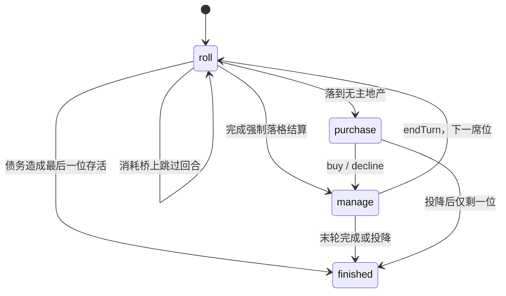

# Monopoly v4 技术架构

[English](TechnicalArchitecture.en.md) · [规则](game-rules.md) · [协议](../../server/PROTOCOL.md)

v4 将规则从界面和房间服务中提取为同一套无依赖 ESM 模块。单机在浏览器调用规则；联机由服务器调用规则并广播完整快照。客户端不能提交金额、骰子、所有权或自算后的状态。

## 模块边界

| 路径 | 职责 |
| --- | --- |
| `shared/data.js` | 唯一的 36 格棋盘、21 处地产和色组定义，含中文/英文名 |
| `shared/index.js` | 规则参数、纯状态转换、合法动作、估值、租金和 AI |
| `shared/CONTRACT.md` | 状态、动作、错误码及参数约定 |
| `monopoly/src/App.vue` | 本地模式、房间模式、回合操作与页面状态 |
| `monopoly/src/components/` | 棋盘和地产详情等展示组件 |
| `monopoly/src/i18n.js` | 界面、错误及事件日志的中英文转换 |
| `monopoly/src/online/client.js` | WebSocket 请求、快照、会话保存和重连 |
| `server/server.js` | HTTP 静态托管、房间、身份验证、版本校验、权威动作执行和回合计时 |
| `tests/engine.test.js` | 规则与 AI 回归 |
| `tests/server.test.js` | 真实本地 HTTP/WebSocket 集成测试 |
| `scripts/simulate.js` | 固定种子、多难度、轮转座位的 AI 自博弈 |

项目根为 npm workspace，子应用为 `monopoly` 与 `server`。前端使用 Vue 3 + Vite；服务端使用 Node.js 原生 HTTP 与 `ws`。共享规则无第三方依赖。当前运行环境要求见根 `package.json`。

## 共享状态与动作

```js
const state = createGame({ players, seed, maxRounds: 40 });
const actions = getLegalActions(state, playerId);
const next = applyAction(state, playerId, actions[0]);
```

`applyAction` 不修改输入，每次接受动作返回新的 JSON 可序列化状态，`revision` 增加一次；非法动作抛出带稳定 `code` 的错误。状态包含 v4 版本号、轮次、当前玩家 ID、现金、资产、生态、日志、胜者和内部随机状态。玩家 ID 在整局保持稳定，破产标记不会通过删除数组元素改变其他席位身份。

所有客户端共用 `getLegalActions`，引擎仍独立校验每次动作。正常状态机为：



管理动作是 `build`、`sellBuilding`、`mortgage`、`redeem`、`aquaculture`、`equip`、`invest`。`surrender` 是唯一可由非当前存活玩家提交的游戏动作。`purchase` 阶段只能购买、放弃或投降；租金和罚款自动处理，没有逃租动作。终局锁拒绝所有后续动作。

净资产、债务清算、色组加成和升级互斥各只有一套实现。债务支付先回收资产再转移实际款项；未偿还欠款不会增加债权人现金。抵押估值扣本金，铁三角只加条件积分。详细参数以共享导出与[规则](game-rules.md)为准。

## 单机路径

本地操作直接调用共享状态转换，AI 也调用相同的 `chooseAIAction` 和 `applyAction`。浏览器按接受后的快照自动保存 v4 对局到 `localStorage`，支持继续本地游戏；同设备多真人依次交接操作。v3 存档不迁移。

单机随机使用种子生成器。开局种子、玩家顺序、轮数和相同动作序列可以用于复现故障；恢复本地保存同时恢复随机状态，不重新开一套随机序列。种子随机适用于游戏与调试，不作为密码学工具。

## 联机请求与权威快照

生产前端和 WebSocket 由同一服务提供。浏览器依据当前地址连接 `/ws`，HTTPS 页面自动使用 `wss:`；开发服务器把 `/ws` 代理到本地后端。没有写死的公网 IP，也没有要求用户手填服务器地址的界面。

请求格式为 `{id,type,payload}`。游戏动作示例：

```json
{
  "id": "request-123",
  "type": "action",
  "payload": { "revision": 12, "action": { "type": "build", "propertyId": "prop_03" } }
}
```

服务器从当前 WebSocket 绑定的席位解析玩家身份，检查房间、回合、状态版本和合法动作后执行。广播 `{type:"snapshot",payload:{room,game}}`；客户端以权威快照替换游戏状态，不进行联机乐观扣款，也不在本地另跑一套联机结算。

- 同一连接缓存最近 128 个请求 ID 的结果；同 ID 同请求返回缓存结果，同 ID 不同请求拒绝。
- 游戏动作必须携带当前 `revision`；旧版本拒绝为 `STALE_REVISION`。
- 客户端断线后不自动重放未确认动作，恢复会话后接受最新快照，避免买两次或掷两次。
- 完整快照包含最近最多 200 条结构化事件，界面按事件码翻译，服务器无需持有每个用户的显示语言。
- 公开快照剥离 `seed`、`rngState`、会话令牌和令牌摘要。服务器每次掷骰前使用 Node.js 密码学随机源刷新内部随机状态，因此不提供只靠开局种子的线上重放。

消息与错误的完整列表见 [PROTOCOL.md](../../server/PROTOCOL.md)。

## 会话、断线与自动回合

创建或加入房间返回房间码、稳定玩家 ID 和私有会话令牌。客户端按浏览器标签页保存到 `sessionStorage`；刷新或重连使用该会话认领原席位。服务端保存令牌 SHA-256 摘要并恒定时间比较，公开快照不包含认证材料。相同席位在新连接恢复时，旧连接被替换。

普通断线保留席位、资产和会话。真人回合默认有 **60 秒固定截止时间**，管理动作不会延长；超时后共享 AI 完成这一回合。重连后在下一自己的回合恢复人工操作。房主断线或离开会转移主持权。

主动离开正在进行的房间与投降不同：`leave` 将席位永久转为 AI、保留资产并注销原令牌；`surrender` 走规则引擎的破产式退出。自动玩家每个动作间隔约 200 毫秒，以免阻塞事件循环。

等待开局需要 2–4 个席位，真人连接并准备，房主才能开始。已结束的房间可重开；不在线的人类等待席位可由房主移除，AI 可增减。玩家不能加入正在进行的对局。

## 运行与部署边界

后端是**单进程内存房间服务**。没有数据库、跨进程协调、账号系统或持久化战局。服务器重启后房间和会话消失；无在线真人的房间约 30 分钟后回收，长期无活动的房间约 24 小时后回收。不要用多 worker 或多副本负载均衡部署它。

服务提供 `/healthz`；生产静态文件来自 `monopoly/dist`。WebSocket 默认允许同 host 的浏览器 Origin，可通过 `ALLOWED_ORIGINS` 指定允许源；无 Origin 的非浏览器连接也允许。帧大小、连接数、请求速率和慢客户端有基本限制。公网仍需配置域名、TLS 以及反向代理 WebSocket Upgrade。具体命令见[部署指南](../deploy/deployment-guide.md)。

## AI 与验证

AI 策略不改变规则或随机结果。每个决策只读取公开游戏信息：剩余轮数、现金储备、自有地产、对手租金、色组进度和投资份额。简单、普通、困难使用不同储备与收益评估；困难用公开棋盘、两骰组合、固定传送和跳过回合建立落点概率估计，按预期回报分配预算。它不会读取 `rngState` 预测未来骰子。

```bash
npm test
npm run build
npm run simulate -- --seeds 100
```

引擎回归覆盖非法阶段/非本人回合、强制租金、债务实际回收、投资额度与分红去重、升级互斥、抵押净值、传送与过起点、跳过回合、完整末轮、平局、终局锁和 AI 全局合法性。服务端集成测试通过真实本地 WebSocket/HTTP 验证房间与动作流程。AI 自博弈统计见[规则文档](game-rules.md)。

本地测试、浏览器验证与模拟不等于真实公网服务器部署、真实移动设备或长时间多用户压力验证。当前架构支持部署验证，但需在实际服务器环境完成域名、TLS、代理和跨设备验收。
